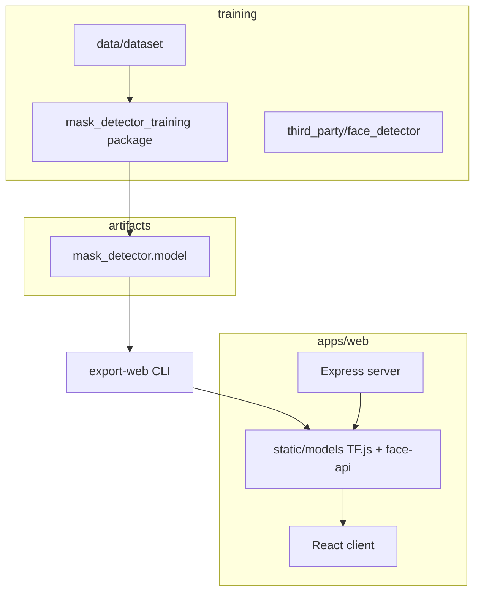

# Project 3: Face-Mask-Detector — overview

## At a glance

| | |
|---|---|
| **Category** | Computer vision + full-stack web — mask vs no-mask classification |
| **Work type** | Keras training, OpenCV DNN + TF.js deployment, React UI |
| **Skills** | Transfer learning (MobileNetV2), TF.js export, Express static hosting, face-api.js |
| **Tech stack** | Python (TensorFlow, OpenCV), JavaScript (React 18, Vite, MUI v5, Express), monorepo layout |

## What this project does

Trains a **binary mask classifier** on image folders, runs **Python** demos on images/webcam using a **Caffe SSD** face detector, exports the same weights to **TensorFlow.js** for the **browser**, and serves a **React** app for **upload** and **webcam** modes.

## Repository layout

## Main features

| Area | Features |
|------|-----------|
| **Training** | CLI `mask-detector-train`; MobileNetV2 head; augmentations; metrics + plot to `artifacts/` |
| **Offline** | `mask-detector-infer-image`, `mask-detector-infer-video` (shared pipeline module) |
| **Web export** | `mask-detector-export-web` → `apps/web/.../static/models/maskModel/` |
| **Web app** | Webcam + image modes; optional `VITE_MODEL_BASE_URL` for cross-origin deploys; TF.js via npm |

## CLI entry points

Install from [`training/`](training/README.md): `mask-detector-train`, `mask-detector-infer-image`, `mask-detector-infer-video`, `mask-detector-export-web`.

## Version control

Git history originates from the former **`maskOn`** web repo; the Python training tree and monorepo layout were added in a consolidation refactor.

## Related docs

- [README.md](README.md) — end-to-end pipeline
- [training/README.md](training/README.md) — Python env and commands
- [apps/web/README.md](apps/web/README.md) — web dev/prod
